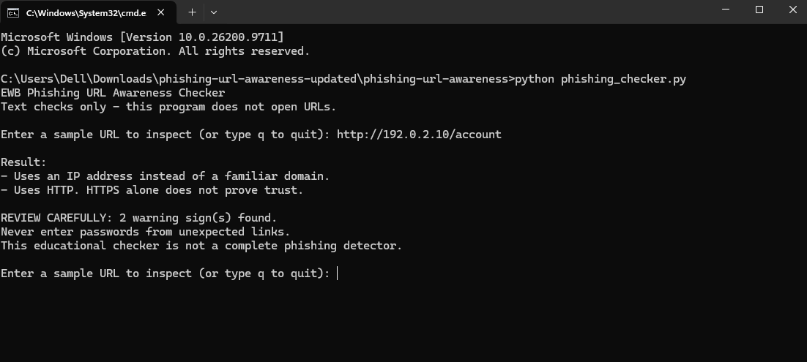
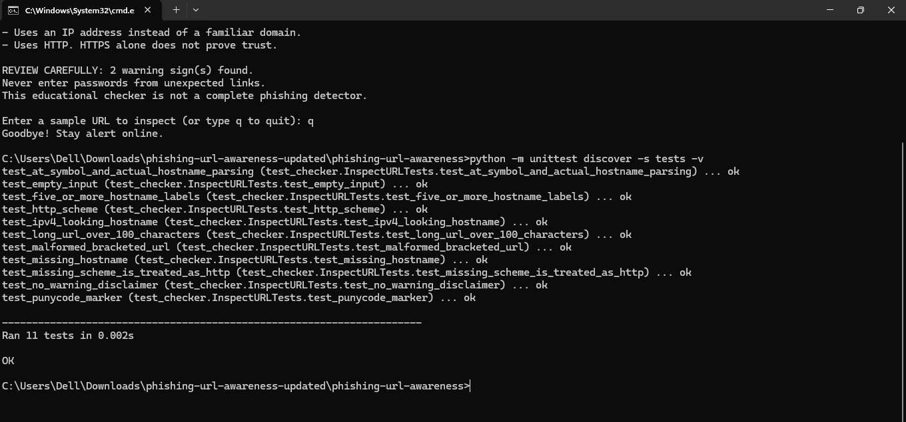

# EWB Phishing URL Awareness Checker

## Overview

Phishing is a trick where fake links or messages try to get people to share private information. This Python program checks the text of a URL and shows some warning signs. It does not open the link or visit the website.

## Features

- Detects an @ symbol in the URL
- Flags unusually long URLs (over 100 characters)
- Flags IP-address hostnames
- Flags many hostname segments (5 or more)
- Flags punycode-style hostnames (xn--)
- Flags the HTTP scheme
- Lets the user check more than one URL before quitting
- Handles empty or incorrectly formatted input without crashing

## Requirements

Python 3.10 or later. No extra packages.

## How to Run

Windows:
```bat
python phishing_checker.py
```

Mac/Linux:
```bash
python3 phishing_checker.py
```

Type a URL when asked. To stop the program, type `q`.

## Example Output

Input:
`http://192.0.2.10/account`

```text
Result:
- Uses an IP address instead of a familiar domain.
- Uses HTTP. HTTPS alone does not prove trust.

REVIEW CAREFULLY: 2 warning sign(s) found.
Never enter passwords from unexpected links.
This educational checker is not a complete phishing detector.
```

## Testing

| # | Input | Expected | Actual | Result |
|---|---|---|---|---|
| 1 | `https://www.example.com/login` | No warning signs found | No listed warning signs found. This does NOT prove safety. | PASS |
| 2 | `http://192.0.2.10/account` | IP address and HTTP warnings | IP address and HTTP warnings shown | PASS |
| 3 | `http://example.com@sample.invalid/login` | @ symbol and HTTP warnings | @ symbol and HTTP warnings shown | PASS |
| 4 | `https://a.b.c.d.e.example.invalid/path` | Many hostname segments warning | Many hostname segments warning shown | PASS |
| 5 | `https://xn--example.invalid/` | Punycode-style hostname warning | Punycode-style hostname warning shown | PASS |

These results were checked in the project build environment. Run the program and tests on your own computer before submitting your work.

To run the automated tests:
```bat
python -m unittest discover -s tests -v
```

## Screenshots





Capture these screenshots from your own computer and save them with the names shown above.

## Improvements

1. I added a loop so I can check several URLs without restarting the program.
2. I added error handling for incorrectly formatted URLs so the program can show a message instead of crashing.

## Limitations

This is an educational tool. It only reads URL text. It does not visit URLs, scan for malware or prove that a URL is safe. No warning signs found does NOT mean a URL is safe.

## Ethical Use

Use sample strings only. Do not collect credentials. Do not use this project to deceive anyone or to test websites without permission.

## Author

Venkatesh Bathula , EWB Courses
